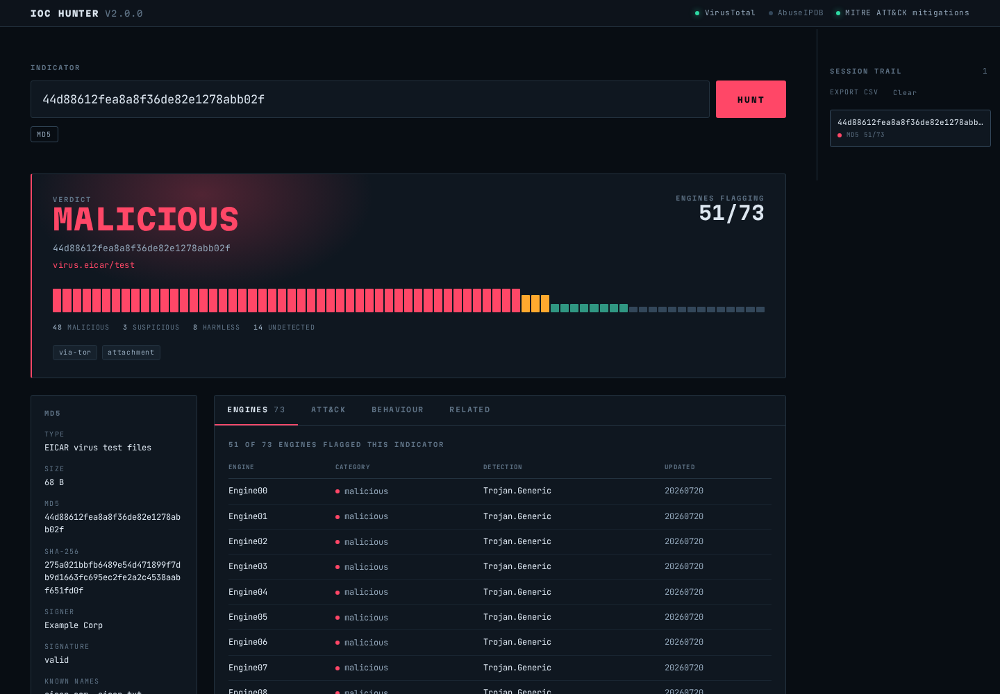
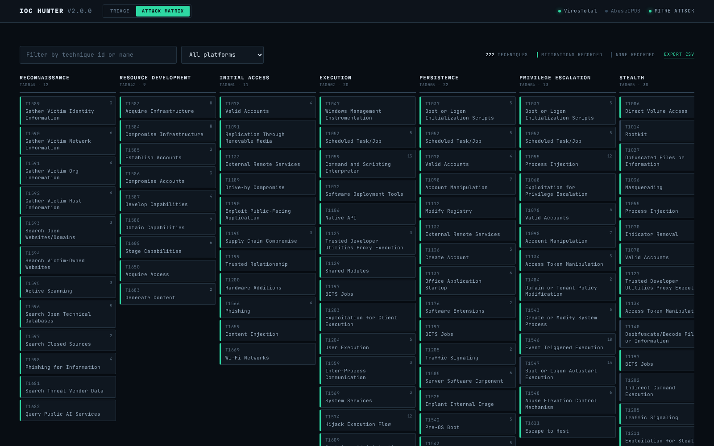

# IoC Hunter

Threat intelligence triage for the four things that actually land in a ticket: **file hashes, IP
addresses, domains and URLs**. Paste an indicator — defanged or not — and get one report shape back,
whatever type it was.

`FastAPI` · `React` · `TypeScript` · `Docker` · `VirusTotal` · `AbuseIPDB` · `MITRE ATT&CK` · 221 tests



---

## What it does

- **One report shape for every indicator type.** A hash, an IP, a domain and a URL all normalise to
  the same verdict, engine statistics, reputation and timestamps, with a type-specific detail block
  underneath. A triage reads the same way regardless of what you were handed.
- **Reads defanged indicators.** `evil[.]com`, `hxxps://`, `192.168.1[.]1` and `evil(dot)com` are
  refanged before lookup, so indicators paste straight out of a report or an email.
- **Maps sandbox techniques to ATT&CK mitigations.** Techniques observed during detonation are
  matched against MITRE's own technique-to-mitigation data, so the report says what to *do* about a
  finding, not only what happened.
- **Browses the ATT&CK matrix offline.** The whole Enterprise matrix ships with the app — 15 tactics,
  222 techniques and 475 sub-techniques — filterable by platform and searchable by name, with no
  network call. A technique observed in a triage is one click from its place in the matrix.
- **Pivots between indicators.** Contacted domains and passive DNS resolutions are one click from
  becoming the next lookup.
- **Exports.** The session's lookups, or the entire ATT&CK catalogue, as CSV.

## Rate limits, and why the UI is shaped this way

VirusTotal's free tier allows **4 requests per minute and 500 per day**. That budget drives the
design:

| Action | Upstream requests |
|---|---|
| Look up any indicator | 1 |
| Load sandbox behaviour and ATT&CK | 2, only when you open the tab |
| Load connected indicators | 1, only when you open the tab |
| Repeat a lookup within the cache window | 0 |

A primary lookup is always exactly one request. The heavier panels load on demand, and responses are
cached in-process (15 minutes by default), so re-opening an indicator from the session trail costs
nothing. When the quota does run out the API returns 429 and the interface says so plainly.

## Running it

You need a free [VirusTotal API key](https://www.virustotal.com/gui/my-apikey). An optional
[AbuseIPDB key](https://www.abuseipdb.com/account/api) adds reporting history to IP reports.

```bash
cp .env.example .env
# edit .env and set VT_API_KEY
```

### Docker

```bash
docker compose up --build
```

Then open <http://localhost:8080>.

### Locally

Backend:

```bash
cd backend
python -m venv .venv && source .venv/bin/activate
pip install -e ".[dev]"
uvicorn app.main:app --reload
```

Frontend, in a second shell:

```bash
cd frontend
npm install
npm run dev
```

The dev server proxies `/api` to the backend, so open <http://localhost:5173>.

To serve everything from the backend alone, build the frontend first (`npm run build`); the API then
serves `frontend/dist` at the root.

## API

Interactive docs are at `/docs`. Indicators are passed as a query parameter, so URLs need no
escaping.

| Endpoint | Purpose |
|---|---|
| `GET /api/classify?indicator=` | How the service reads a string, without querying any provider |
| `GET /api/lookup?indicator=` | The normalised report |
| `GET /api/behaviour?indicator=` | Sandbox activity and ATT&CK coverage, for file hashes |
| `GET /api/relations?indicator=` | Connected indicators |
| `GET /api/history` | This session's lookups |
| `GET /api/history/export.csv` | This session's lookups as CSV |
| `DELETE /api/history` | Discard this session's lookups |
| `GET /api/health` | Service version and provider availability |
| `GET /api/attack/matrix?q=&platform=` | The ATT&CK matrix, optionally filtered |
| `GET /api/attack/techniques/{id}` | One technique with its sub-techniques and parent |
| `GET /api/attack/export.csv` | The whole ATT&CK catalogue as CSV |

History is keyed to a session cookie, so one browser's lookups stay separate from another's. The
ATT&CK endpoints read the bundled catalogue and never call out to a provider, so they cost no quota.

## The ATT&CK matrix



The matrix view is a browsable copy of Enterprise ATT&CK, served from a 0.9 MB file that ships with
the app. Tactics run in MITRE's own order; each cell is marked by whether ATT&CK records a mitigation
for that technique, which is usually the question a defender is asking of the matrix. Opening a cell
gives the description, platforms, mitigations and sub-techniques.

After you triage a file and load its sandbox report, the techniques that sample was observed using
are highlighted in the matrix, and technique ids in the report link straight to them.

`GET /api/attack/export.csv` returns the whole catalogue as one row per technique and sub-technique —
id, name, tactics, platforms, mitigations, description and link.

## Tests

```bash
cd backend && pytest
```

221 tests. Upstream responses are mocked with `respx`, so the suite runs offline.

## Refreshing the ATT&CK data

The bundled catalogue is built from MITRE's official Enterprise ATT&CK STIX bundle. Regenerate it
after an ATT&CK release:

```bash
python tools/refresh_attack_data.py                    # current release
python tools/refresh_attack_data.py --version v18.0    # pin a release
```

The tool resolves technique-to-mitigation relationships, orders tactics as the matrix presents them,
and reduces ATT&CK's markdown and inline `(Citation: …)` markers to plain prose.

## Layout

```
backend/
  app/
    ioc.py                 indicator recognition and refanging
    models.py              the normalised report shape
    data/attack.json       the bundled ATT&CK catalogue
    providers/             VirusTotal and AbuseIPDB clients
    services/              caching, normalisation, ATT&CK catalogue, export
    routers/               HTTP surface
  tests/
frontend/
  src/components/          verdict banner, engine meter, report panels, matrix
tools/
  refresh_attack_data.py
```

## Background

IoC Hunter started as a take-home for a threat intelligence interview: a single-file FastAPI script
that looked up file hashes on VirusTotal and dumped the result to CSV. This version keeps the idea
and rebuilds the rest — multi-indicator support, a normalised report shape, on-demand loading around
the free-tier rate limit, a React and TypeScript frontend, and a test suite.

The matrix view absorbs an earlier project of mine, `ttps-magician`, which scraped every technique
page on attack.mitre.org one request at a time to build a spreadsheet. It reads the official STIX
bundle instead: one download rather than roughly 700 scraped pages, nothing to break when MITRE
changes their markup, and the same tabular export is still one click away.

## The magicians

Alongside this sit a few small, standalone scripts — the ones that came first, each answering one
question without a server or a build step:

- [ttps-magician](https://github.com/fsola99/ttps-magician) — every ATT&CK technique, as a spreadsheet
- [groups-magician](https://github.com/fsola99/groups-magician) — which techniques a given threat group uses
- [json-magician](https://github.com/fsola99/json-magician) — what changed between two ATT&CK releases
- [hash-magician-reloaded](https://github.com/fsola99/hash-magician-reloaded) — hashes of every file in a folder, as CSV
- [Hash-Magician](https://github.com/fsola99/Hash-Magician) — the same, on PySimpleGUI

## Acknowledgments

- [VirusTotal](https://www.virustotal.com/) and [AbuseIPDB](https://www.abuseipdb.com/) for their APIs.
- [MITRE ATT&CK](https://attack.mitre.org/) for the technique and mitigation data.
